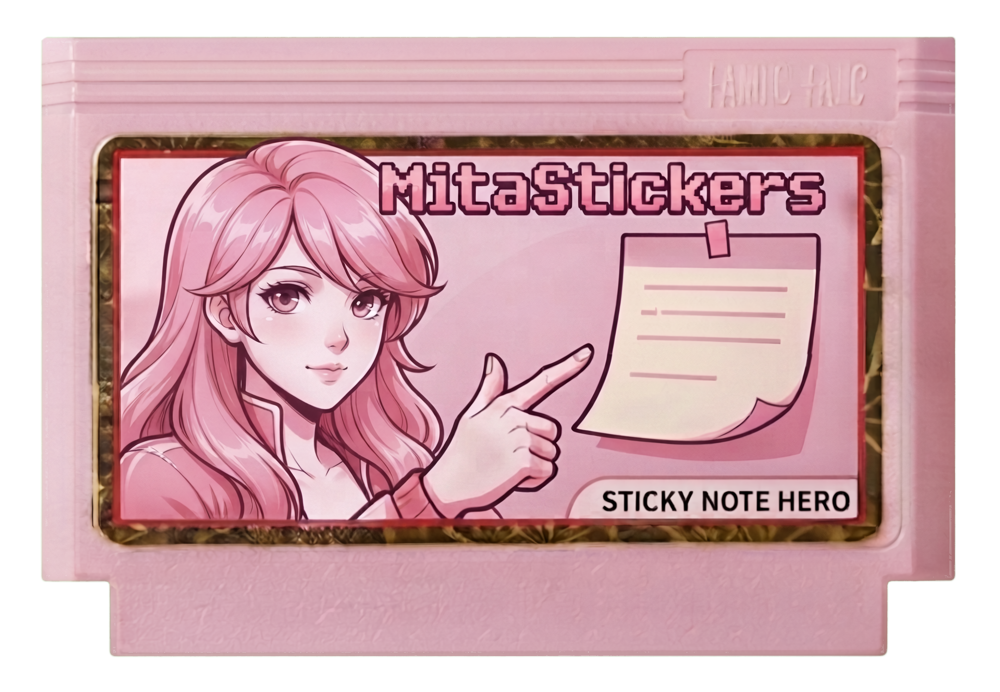
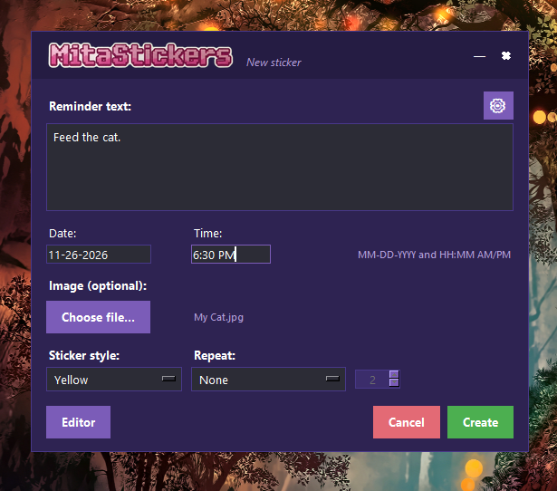
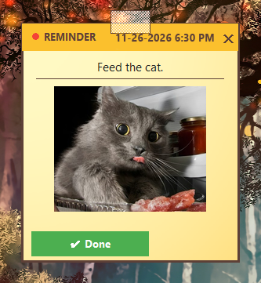
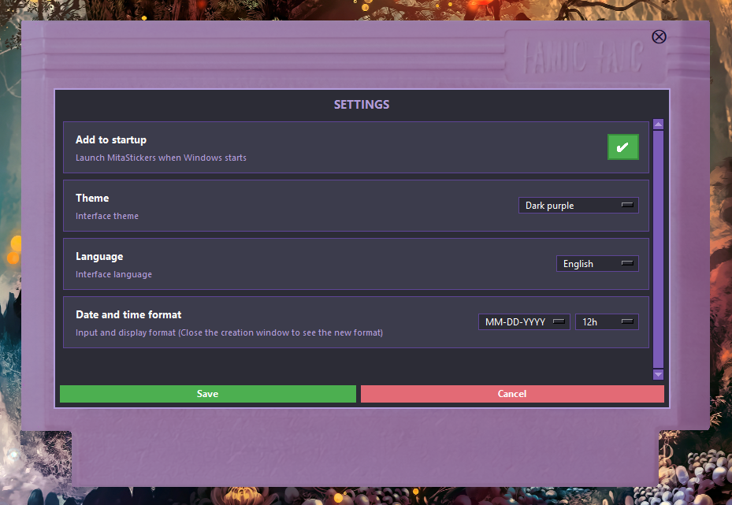

# MitaStickers 0.1

<p align="center">
  
</p>

<p align="center" style="font-size: 33px; font-weight: bold;">
  🌐 <b><a href="README.md">Русский</a></b> | <b>English</b>
</p>

## 📝 About the Program

**MitaStickers** is a desktop application for Windows that helps you remember important tasks. The program displays pop-up reminder stickers styled like Mita's console, making them impossible to miss.

### ✨ Key Features:
*   **Stylish design**: Choose between two themes — soft pink (Pink) and bold dark purple (Purple). The windows are styled like cartridges.
*   **Two languages**: Full support for Russian and English (switchable in the settings).
*   **Flexible reminders**: Set an exact date and time, as well as repetitions (every day, week, month, year, or custom intervals).
*   **Images**: Attach any images to your reminders.
*   **Autostart**: The program can launch with Windows and stay in the system tray, waiting for the right moment.
*   **Date formats**: Support for different time formats (24h / 12h AM-PM) and date formats (YYYY-MM-DD, DD-MM-YYYY, MM-DD-YYYY).

### 🖼️ Screenshots:

<table width="100%">
  <tr>
    <td align="center" valign="top" width="33%">
      <b>Creating a sticker</b><br>
      
    </td>
    <td align="center" valign="top" width="33%">
      <b>Sticker</b><br>
      
    </td>
    <td align="center" valign="top" width="33%">
      <b>Settings</b><br>
      
    </td>
  </tr>
</table>

---

## 💻 System Requirements:
*   **OS**: Windows 10 / Windows 11 (64-bit)

---

### 🚀 Installation and First Launch:

1.  Open **[Releases](../../releases)** and download the latest `MitaStickers.exe`.
2.  Place the file in any convenient folder (for example, `C:\MitaStickers\`).
3.  Run `MitaStickers.exe`.
4.  **Important:** On the first launch, your antivirus software or SmartScreen may display a warning — this is normal for programs without a paid digital signature (EV certificate). Click “More info → Run anyway”.
5.  The program will offer to add itself to the startup applications. **It is recommended that you agree** — otherwise, reminders will not work after restarting your PC.
6.  After launching, the  icon will appear in the system tray (next to the clock).  
    **Left-click** — open the main window / create a reminder.  
    **Right-click** — menu: Settings, Exit.

> **Where data is stored**  
> `%LOCALAPPDATA%\MitaStickers\` — reminders, settings, and attached images.  
> This folder is preserved when updating or reinstalling the program, so your data will not be lost.

---

<details>
<summary style="font-size: 24px; font-weight: bold; cursor: pointer;">🛠️ For Developers (Click to expand)</summary>

<br>

*If you want to run the project from source code or build it yourself:*

1. Clone the repository:
```bash
git clone https://github.com/Macter-Kot/MitaStickers.git

cd MitaStickers 
```
2. Install the dependencies:
```bash
pip install -r requirements.txt
```

3. Run in development mode:
```bash
python main.py
```

4. *Build a standalone EXE with PyInstaller:*
```bash
pip install pyinstaller

python -m PyInstaller --noconfirm --onefile --windowed --name MitaStickers --icon assets/icon.ico --add-data "assets;assets" --add-data "locales;locales" main.py
```

## 👉 View the Project Structure:
[Project Structure](PROJECT_STRUCTURE.md)

</details>

---

## Author: [Mactep_KoT_](https://github.com/Macter-Kot)

### 💖 Support the Author

> This project is developed as a passion project. If you like MitaStickers and would like to support its continued development, or simply buy the [Cat](https://github.com/Macter-Kot) a coffee, you can do so here:

<p align="center">
  <a href="https://yoomoney.ru/fundraise/1LL6Q349MMP.261119" target="_blank">
    
  </a>
</p>
<p align="center">
  <i>(Click the cartridge to support the project)</i>
</p>