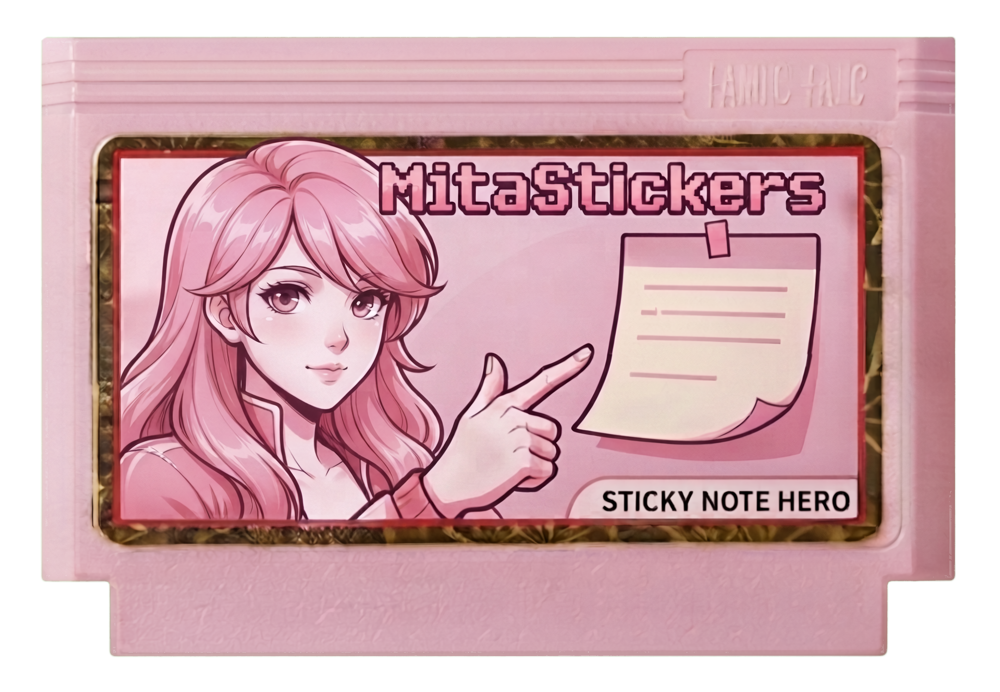
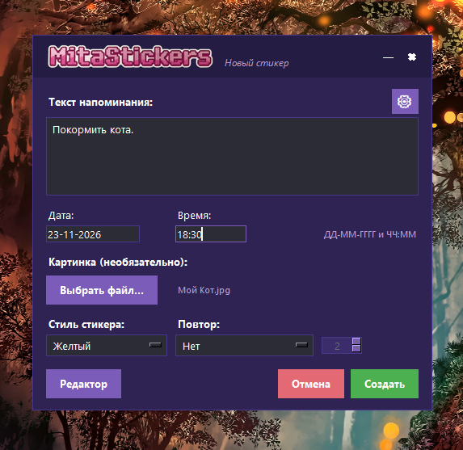
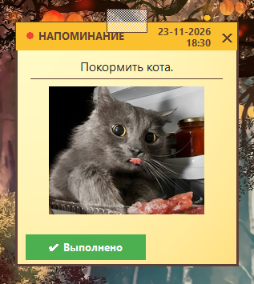
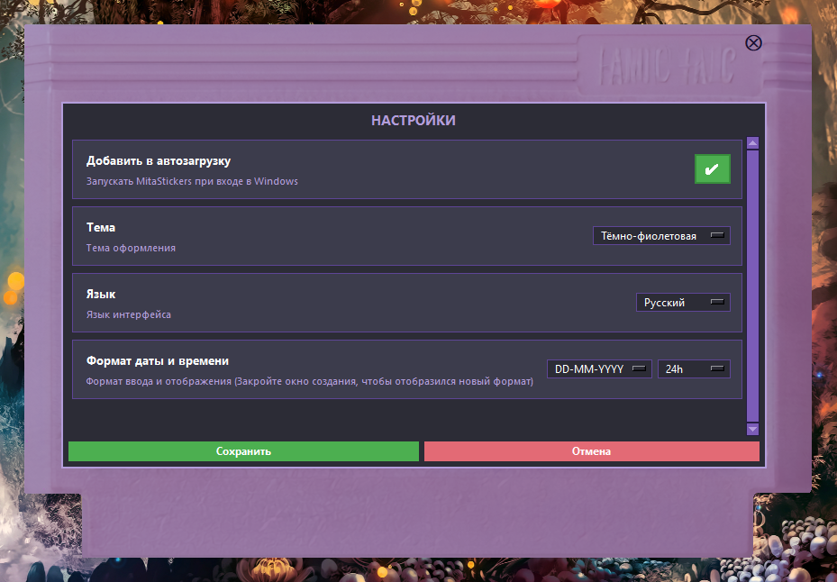

# MitaStickers 0.1

<p align="center">
  
</p>

<p align="center" style="font-size: 33px; font-weight: bold;">
  🌐 <b>Русский</b> | <b><a href="README.en.md">English</a></b>
</p>

## 📝 О программе

**MitaStickers** — это десктопное приложение для Windows, которое помогает не забывать о важных делах. Программа показывает всплывающие стикеры-напоминалки в стиле консоли Миты, которые невозможно пропустить.

### ✨ Основные возможности:
*   **Стильный дизайн**: Два режима оформления на выбор — нежно-розовый (Pink) и брутальный темно-фиолетовый (Purple). Окна стилизованы под картриджи.
*   **Два языка**: Полная поддержка русского и английского языков (переключается в настройках).
*   **Гибкие напоминания**: Настройка точной даты и времени, а также повторений (каждый день, неделю, месяц, год или свои интервалы).
*   **Картинки**: Возможность прикреплять к напоминаниям любые изображения.
*   **Автозагрузка**: Программа может запускаться вместе с Windows и находиться в системном трее, ожидая своего часа.
*   **Форматы дат**: Поддержка разных форматов времени (24h / 12h AM-PM) и дат (ГГГГ-ММ-ДД, ДД-ММ-ГГГГ, ММ-ДД-ГГГГ).

### 🖼️ Как выглядит программа:

<table width="100%">
  <tr>
    <td align="center" valign="top" width="33%">
      <b>Создание стикера</b><br>
      
    </td>
    <td align="center" valign="top" width="33%">
      <b>Стикер</b><br>
      
    </td>
    <td align="center" valign="top" width="33%">
      <b>Настройки</b><br>
      
    </td>
  </tr>
</table>

---

## 💻 Системные требования:
*   **ОС**: Windows 10 / Windows 11 (64-bit)

---

### 🚀 Установка и первый запуск:

1.  Откройте **[Releases](../../releases)** и скачайте последний `MitaStickers.exe`.
2.  Поместите файл в любую удобную папку (например, `C:\MitaStickers\`).
3.  Запустите `MitaStickers.exe`.
4.  **Важно:** при первом запуске антивирус / SmartScreen могут выдать предупреждение — это нормально для программ без платной цифровой подписи (EV-сертификата). Нажмите “Подробнее → Запустить в любом случае”.
5.  Программа предложит добавить себя в автозагрузку. **Рекомендуется согласиться** — иначе напоминания не сработают после перезагрузки ПК.
6.  После запуска иконка  появится в системном трее (возле часов).  
    **ЛКМ** — открыть главное окно / создать напоминание.  
    **ПКМ** — меню: Настройки, Выход.

> **Где хранятся данные**  
> `%LOCALAPPDATA%\MitaStickers\` — напоминания, настройки, прикреплённые картинки.  
> Папка сохраняется при обновлении/переустановке, данные не пропадут.

---

<details>
<summary style="font-size: 24px; font-weight: bold; cursor: pointer;">🛠️ Для разработчиков (нажмите, чтобы развернуть)</summary>

<br>

*Если вы хотите запустить проект из исходного кода или собрать его самостоятельно:*

1. Клонируйте репозиторий:
```bash
git clone https://github.com/Macter-Kot/MitaStickers.git

cd MitaStickers 
```
2. Установите зависимости:
```bash
pip install -r requirements.txt
```

3. Запустите в режиме разработки:
```bash
python main.py
```

4. *Полный EXE* (PyInstaller)
```bash
pip install pyinstaller

python -m PyInstaller --noconfirm --onefile --windowed --name MitaStickers --icon assets/icon.ico --add-data "assets;assets" --add-data "locales;locales" main.py
```

## 👉 Посмотреть структуру проекта:
[Project Structure](PROJECT_STRUCTURE.md)

</details>

---

## Автор: [Mactep_KoT_](https://github.com/Macter-Kot)

### 💖 Поддержать автора

> Проект развивается на энтузиазме. Если вам нравится MitaStickers и вы хотите поддержать дальнейшую разработку, или просто угостить [Кота](https://github.com/Macter-Kot), вы можете сделать это здесь:

<p align="center">
  <a href="https://yoomoney.ru/fundraise/1LL6Q349MMP.261119" target="_blank">
    
  </a>
</p>
<p align="center">
  <i>(Нажмите на картридж, чтобы поддержать)</i>
</p>